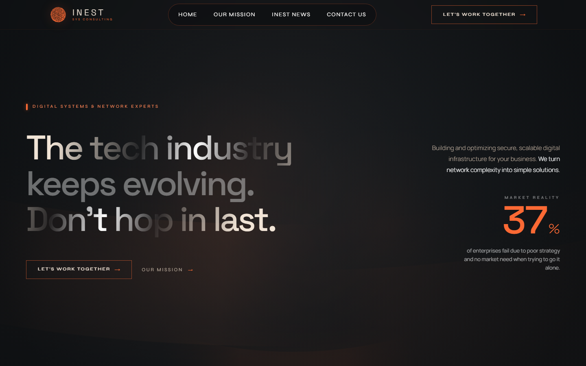
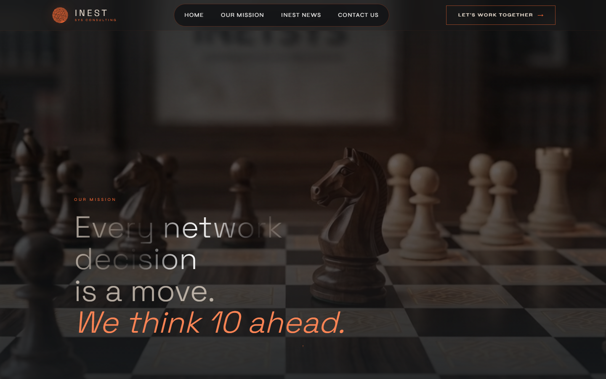

# iNestSys Consulting — Web Platform

<div align="center">

  
  
  
  
  

  <br/><br/>

  <p align="center">
    <b>Enterprise-grade conceptual web platform & neural engineering portfolio showcase.</b><br/>
    <i>Engineered with Next.js 14 App Router, WebGL Three.js particle dynamics, and live curated tech intelligence feeds.</i>
  </p>

</div>

---

## 📸 Visual Gallery & Architecture Showcase

### 1. Enterprise Portal & Interactive 3D Quantum Mesh
The landing interface incorporates custom WebGL particle shaders, dynamic glow auras, and precision cyber-typography.



<br/>

### 2. Strategic Mission & Zero-Trust Architecture
In-depth consulting presentations covering digital systems, infrastructure modernization, and security roadmaps.



---

## ⚡ Core Engineering Highlights

### 🌐 Dual-Feed Intelligence Hub
- **Live Industry Tech News**: Real-time aggregator querying major technology feeds (TechCrunch, The Verge, Wired, Ars Technica, MIT Technology Review) with direct verified external links.
- **Company Whitepapers & Case Studies**: In-depth internal research articles accompanied by an interactive full-screen reader modal, key client takeaways, and estimated reading times.
- **Dynamic Category Filtering**: Real-time filtering across AI & Machine Learning, Enterprise Infrastructure, Cybersecurity, and Cloud Systems.

### 🎨 Visual & Motion Design System
- **Three.js WebGL Shaders**: Interactive particle canvas reacting to mouse positioning and viewport scrolling.
- **Framer Motion Micro-Interactions**: Smooth staggered scroll-reveals, responsive drawer modals, and slide-in action buttons.
- **Cyber-Corporate Palette**: Obsidian dark theme (`#07070a`) complemented by high-energy crimson telemetry accents (`#FF2A55`).

---

## 📂 Repository Structure

```
site/
├── app/
│   ├── api/
│   │   └── news/
│   │       └── route.ts          # Serverless RSS news aggregator API
│   ├── globals.css               # Design system & CSS custom properties
│   ├── layout.tsx                # Root layout with Space Grotesk & Syne fonts
│   └── page.tsx                  # Primary page orchestrator
├── components/
│   ├── NewsPage.tsx              # Comprehensive intelligence & case study reader
│   ├── ThreeBackground.tsx       # Three.js WebGL particle mesh canvas
│   ├── Hero.tsx                  # Hero section with interactive CTA
│   ├── Mission.tsx               # Enterprise advisory & modernization section
│   └── ui/                       # Reusable micro-components (buttons, modals)
├── lib/
│   └── news-data.ts              # Curated datasets & TypeScript type definitions
└── public/                       # High-resolution media & vector assets
```

---

## 💻 Local Developer Guide

This repository is maintained as an **academic and developer portfolio project**. To clone, explore, and run the project locally on your machine:

### 1. Clone the repository
```bash
git clone https://github.com/oeudiredoli-dev/inestsys-consulting.git
cd inestsys-consulting
```

### 2. Install dependencies
```bash
npm install
```

### 3. Launch local development server
```bash
npm run dev
```

### 4. Open in your browser
Navigate to:
```
http://localhost:3000
```

*(The server will stay active in your terminal while you test and explore the platform).*

---

## 👨‍💻 Author

**Oeudire Doli**  
*Computer Science & Artificial Intelligence Student*  
GitHub: [@oeudiredoli-dev](https://github.com/oeudiredoli-dev)
